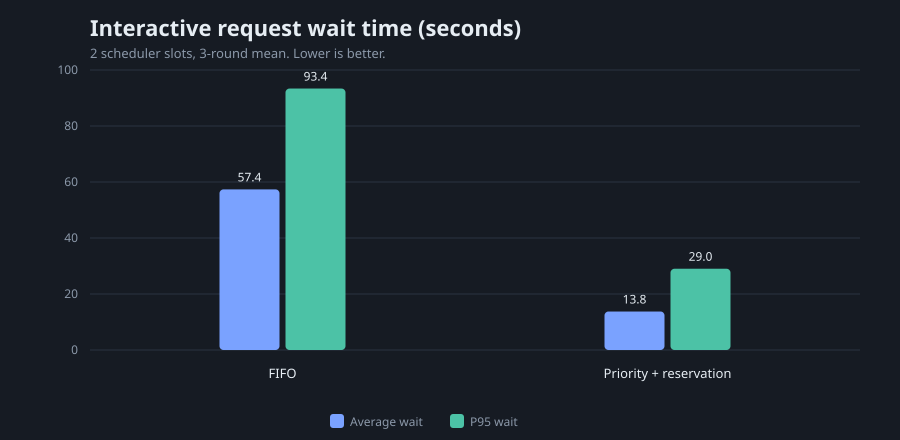
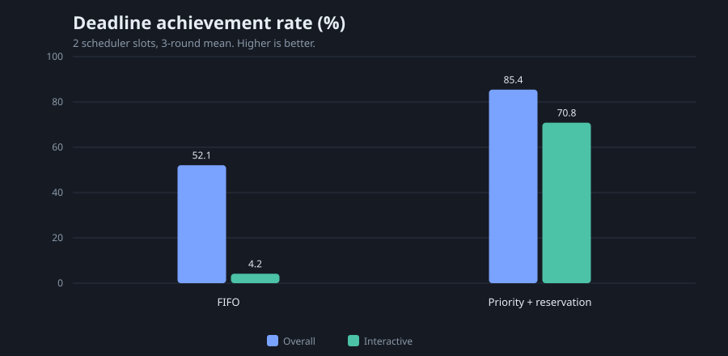

# 进阶阶段考核报告

姓名：金琪凯

项目名称与选题：请求优先级判断与调度优化

GitHub 仓库、分支与最终 commit SHA：待推送后填写；计划分支 `basic-task`

完成日期：2026-10-19

## 1. 应用场景与问题

服务对象为 7 人工作室。客户演示现场通知、制度问答和故障排查是交互任务，文档整理、代码审查和代码改造是后台任务。两者共用同一台 RTX 5060 Laptop 和本地 llama-server。

基础阶段的测试显示：当 4 个客户端请求同时到达、服务只有 1 个 slot 时，TTFT 从约 0.08 秒升到约 40 秒；增加 slot 能解决容量问题，但不能决定“谁先获得空出的 slot”。

本阶段要解决的问题：

1. 后台任务先到达时，交互任务不应长期排在队尾。
2. 交互任务的期限达成率应明显提高。
3. 后台任务不能被无限饿死，最大等待需要可控。
4. 调度策略应可复现、可记录、可与 FIFO 固定回放比较。

观察依据：

- 官方参考请求序列：16 条请求、7 个用户、到达偏移 0–6000 ms、8 类任务。
- 交互任务期限 15–45 秒，后台任务期限 180–240 秒。
- 基础阶段已确认模型和 llama-server 在 GPU 上稳定运行。

## 2. 调研与方案选择

参考内容：

- llama.cpp/llama-server 的 OpenAI 兼容流式接口，用于逐请求记录首 token 和完成时间。
- 基础阶段已经完成的服务层、固定负载测试和恢复机制。
- 常见调度思路：严格优先级、等待老化、饥饿保护、容量预留。

方案选择：

- 不使用外部决策模型，改用规则表，保证优先级判断可复现、无额外网络依赖。规则输入包括 `interaction_mode`、`task_type` 和 `deadline_after_arrival_ms`。
- 在服务层实现等待队列和 slot 分配，llama-server 继续负责推理。这样不需要修改引擎，便于对比和复现。
- 基线使用 FIFO；优化使用“优先级 + 等待老化 + 8 秒饥饿保护 + 后台并发上限 1”。

自己的开发内容：

- 请求模型和优先级规则：`src/models.py`、`src/priority.py`、`configs/priority_rules.json`
- 调度器：`src/scheduler.py`
- llama-server 流式后端：`src/backend.py`
- 固定到达回放和指标：`src/replay.py`
- 单元测试：`tests/test_priority.py`、`tests/test_scheduler.py`

## 3. 环境与复现条件

| 项目 | 信息 |
| --- | --- |
| GPU、显存、CPU、内存和磁盘 | RTX 5060 Laptop，8151 MiB；Intel Core Ultra 7 251HX；WSL 7.5 GiB 内存；磁盘约 955 GB 可用 |
| Windows、WSL、Linux、驱动及 CUDA | Windows 11；WSL2 Ubuntu 24.04；内核 6.18.54.1-microsoft-standard-WSL2；驱动 596.56；CUDA 13.2.86 |
| llama.cpp／开源项目版本或 commit | llama.cpp v0.7.0，commit `620d2225cc436ab0b001e3200e590e3b286ef9ab` |
| 模型来源、版本、量化与校验值 | ModelScope `Qwen/Qwen2.5-7B-Instruct-GGUF`，Q4_K_M；分片 SHA256 `dfce12e3862a5283ccfb88221b48480e58745165de856439950d0f22590580db`、`539cf93f78e887edea1c04e2d7d8cdaca9d01dae9c9025bcb8accbe29df3d72a` |
| 模型权重和计算位置 | 全部 29/29 层 offload 到 CUDA0；权重约 4168 MiB |
| 上下文、输出预算、并发及 slot | llama-server 总上下文 32768，4 个 slot，每 slot 8192；调度器使用 2 个 slot；输出预算 256–3072 tokens |
| KV 类型、各层容量与存放位置 | q8_0 K/V，CUDA0 KV buffer 952 MiB，4 个独立 slot，全部在 GPU |
| 决策模型、调用方式和版本 | 未使用外部决策模型；规则表本地计算 |

## 4. 系统设计与实现

```text
参考请求序列（16 条，按 arrival_offset_ms 到达）
                    │
                    ▼
             调度器 Scheduler
   ┌────────────────┼────────────────┐
   │ 优先级规则      │ 等待老化/饥饿保护 │ 后台并发上限
   └────────────────┼────────────────┘
                    ▼
              等待堆（priority queue）
                    │ 2 个调度 slot
                    ▼
        llama-server :8080（4 个 slot）
                    │
                    ▼
             GPU 推理 + 流式输出
```

关键数据结构：

- `RequestSpec`：请求 ID、用户/会话、任务类型、交互模式、期限、输出预算、业务背景、提示词和资料。
- `PriorityDecision`：分数、等级（high/medium/low）和判断理由。
- `RequestRun`：到达、入队、分配、首 token、完成时间，基础优先级和实际生效优先级，输出和 token 数。
- `Scheduler`：优先堆、`asyncio.Condition`、slot 信号量、老化任务、`batch_limit` 和后台运行计数。

策略：

1. 基础分：interactive 60，batch 20。
2. 任务加分：现场通知 +30，故障排查 +25，制度问答 +15，代码审查 +5，代码改造 −5。
3. 期限加分：≤20 s +20，≤45 s +10，≤180 s 0，其他 −5。
4. 等待老化：每 10 秒 +1，最高 +30。
5. 饥饿保护：等待 ≥8 秒 +100，保证后台任务获得一次执行机会。
6. 交互预留：`batch_limit=1`，后台请求最多同时占 1 个调度 slot；交互请求可以使用全部 2 个 slot。

调度器每次 slot 释放时重新计算队列中请求的有效优先级，再从当前最高优先级中取请求，避免“提前锁定低优先级请求”导致高优先级无法插队。

异常处理：

- 后端超时或异常：记录 `failed` 和错误信息，不阻塞其他请求。
- 请求被取消：当前版本没有实现取消接口，列为后续改进。
- 调度器重启：队列不持久化；llama-server 的重启由基础阶段监督器负责。

## 5. 测试负载与判定依据

输入来源：

- `Advanced Task/参考测试（仅作参考）/参考请求序列.jsonl`
- `Advanced Task/参考测试（仅作参考）/测试提示词.md`
- `工作室项目知识库-v1.md`、`v2.md`、`batch_export.py`

负载特征：

- 16 条请求，7 个用户，8 类任务。
- 到达偏移 0–6000 ms，包含同时到达的 3 条后台任务和随后到达的交互任务。
- 输出预算 256–3072 tokens。
- 3 轮 FIFO 和 3 轮 priority + reservation，使用相同请求、相同到达序列、相同模型和相同输出预算。
- 调度器 2 个 slot；llama-server 4 个 slot。

判定依据：

- 期限：完成耗时 ≤ `deadline_after_arrival_ms`。
- 交互任务：`interaction_mode=interactive`，共 8 条/轮。
- 后台任务：`interaction_mode=batch`，共 8 条/轮。
- 输出检查：T05 应使用 v1 的 7 天/3 个工作日/30 天；T06 应使用 v2 的 5 天/2 个工作日/14 天。

## 6. 基线与指标

基线：FIFO，2 个调度 slot，不限制后台并发。

| 指标 | 定义 |
| --- | --- |
| 等待 | 请求到达到获得调度 slot |
| TTFT | 请求到达到第一个非空内容 token |
| 完成耗时 | 请求到达到流结束 |
| 期限达成率 | 完成耗时不超过期限的请求数 / 成功请求数 |
| 低优先级最大等待 | 基础等级为 low 的请求中的最大等待 |
| 吞吐 | 总输出 token 数 / 首请求到达到最后完成的墙钟窗口 |

时间由回放程序的 `time.monotonic()` 采集；优先级规则计算为本地微秒级，不调用外部服务。正式测试 6 轮共 96 个逻辑请求，全部成功，无超时、无重试。

## 7. 开发与优化过程

| 改动编号 | 问题与目标 | 实现位置／配置变化 | 预期作用 | 实际结果 | 代价与影响 | 保留决定 |
| --- | --- | --- | --- | --- | --- | --- |
| A1 | 后台任务先占满队列 | `src/priority.py`，规则表 | 交互任务优先获得空出的 slot | 2-slot mock 平均等待 4.11 → 2.37 s | 低优先级最大等待 6.04 → 8.59 s | 保留 |
| A2 | 严格优先级导致后台饥饿 | 8 秒饥饿阈值 +100 分 | 给低优先级一次兜底机会 | R02 从 9.51 s 等待变为 8.59 s 时被提升 | 可能推迟部分高优先级请求 | 保留 |
| A3 | 后台长任务占满 slot | `batch_limit=1` | 始终给交互任务留出执行能力 | 交互平均等待 57.36 → 13.75 s | 吞吐 67.43 → 63.22 tok/s；后台平均等待 49.27 → 71.10 s | 保留（交互优先场景） |
| A4 | 队列中的低优先级被提前锁定 | 每次分配 slot 前重新计算优先级 | 高优先级请求可在 slot 释放时插队 | 交互期限达成率 4.17% → 70.83% | 后台尾延迟上升 | 保留 |

补充实验：

- 4 个 slot、无后台限制时，FIFO 与 priority 的平均等待都在 0.35 秒左右，几乎没有差别；`batch_limit=2` 反而把平均等待升到 0.76 秒、吞吐从 1665 降到 1373 tokens/s。说明容量充足时不应强行预留。
- 2 个 slot、只做 priority 不做预留时，平均等待从 45.07 降到 43.43 秒，但交互期限达成率仍只有 50%，说明仅排队不够，必须保留执行能力。

## 8. 效果比较与分析

三轮均值（括号内为最小—最大）：

| 运行策略 | 整体等待 | 整体 TTFT | 平均完成耗时 | 期限达成率 | 低优先级最大等待 | 吞吐 |
| --- | ---: | ---: | ---: | ---: | ---: | ---: |
| FIFO 2 slots | 53.31 s（45.07–58.34） | 53.86 s（45.34–58.48） | 69.23 s（60.10–76.14） | 52.08%（50.0–56.25） | 105.88 s（98.57–119.00） | 67.43 tok/s（59.13–73.11） |
| priority + reservation | 42.42 s（39.97–46.27） | 42.56 s（40.09–46.40） | 54.36 s（51.32–58.55） | 85.42%（75.0–93.75） | 121.63 s（115.07–126.55） | 63.22 tok/s（61.70–65.17） |

按交互模式分组：

| 策略 | 交互平均等待 | 交互 P95 等待 | 交互期限达成率 | 后台平均等待 | 后台期限达成率 |
| --- | ---: | ---: | ---: | ---: | ---: |
| FIFO | 57.36 s | 93.37 s | 4.17% | 49.27 s | 100% |
| priority + reservation | 13.75 s | 29.02 s | 70.83% | 71.10 s | 100% |





分析：

- 交互任务平均等待下降 76.0%，P95 等待下降 68.9%，期限达成率从 4.17% 提到 70.83%。
- 整体期限达成率从 52.08% 提到 85.42%，整体平均等待和平均完成耗时分别下降 20.4% 和 21.5%。
- 后台任务平均等待上升 44.3%，低优先级最大等待从 105.88 秒升到 121.63 秒，但仍在 180–240 秒期限内。
- 吞吐下降 6.3%，原因是后台并发被限制为 1，交互任务之间有短时空闲。
- 策略适用于“客户演示/故障排查优先”的交互场景；如果目标是最大吞吐，应使用 FIFO 或更小的预留比例。

## 9. 输出效果、边界与恢复

文档版本核对：

- T05（v1 资料）输出：设备借用最长 **7 个自然日**，已关闭工单 **3 个工作日**回访，每日备份保留 **30 个自然日**，访问故障先联系 **杜言**。与 v1 的 K07/K10/K11/K06 一致。
- T06（v2 资料）输出：设备借用最长 **5 个自然日**，已关闭工单 **2 个工作日**回访，每日备份保留 **14 个自然日**，访问故障先联系 **杜言**。与 v2 的 K07/K10/K11/K06 一致。
- T01 工作群通知、T03 故障排查、T07 代码分析、T08 分批导出改造均完整输出；T08 输出约 1231 tokens，未触及 3072 上限。

边界：

- 即使保留 1 个后台 slot，R14（15–20 秒期限）在 reservation 第 1 轮仍等待 24.5 秒而错过；说明在 2 个 slot 和当前模型速度下，20 秒期限并非总能满足。
- 后台任务在 reservation 下最长等待约 123 秒，仍在 180–240 秒期限内；如果业务期限更紧，需要提高 `batch_limit` 或增加总 slot。
- 4 个 slot 且负载较轻时，priority 与 FIFO 无显著差别；强行 reservation 会降低吞吐。调度策略应与负载强度和业务目标匹配。

恢复：

- 基础阶段的监督器和恢复测试仍然适用于 llama-server；调度器本身不持久化等待队列，进程退出后未完成请求需要客户端重试。这是本阶段的明确限制。
- 正式 6 轮没有出现 llama-server 退出、超时或失败请求。

## 10. 前端与演示

本阶段没有单独开发调度前端，使用固定回放程序的 JSONL、汇总 JSON 和报告图表展示：

- 运行记录：`results/fifo_real_r1..r3`、`results/priority_reserved_real_r1..r3`
- 逐请求：`requests.jsonl` 中的 `priority_label`、`effective_priority_label`、`dispatch_order`、`wait_s`、`deadline_met`
- 汇总：`summary.json` 中的按交互模式、按优先级、期限达成率、低优先级最大等待

现场演示步骤见 `reports/演示清单.md`。

## 11. AI 辅助开发、开源来源与 Git

使用 Codex/GPT-5 辅助完成调度器、优先级规则、回放程序、测试和报告草稿；本人在 WSL + RTX 5060 上实际运行了 mock 和真实模型回放，核对了日志、请求记录和 T05/T06 文档版本。

开源项目：

| 项目 | 版本/来源 | 用途 |
| --- | --- | --- |
| llama.cpp | v0.7.0，commit `620d2225cc436ab0b001e3200e590e3b286ef9ab` | llama-server 推理 |
| Qwen2.5-7B-Instruct-GGUF | ModelScope | 模型权重 |
| 基础阶段服务 | 本仓库 `Basic Task/development` | 服务层、监督器、恢复机制 |
| HTTPX | 0.28.1 | 流式客户端 |

## 12. 总结与复现索引

总结：

- 用规则优先级、等待老化、8 秒饥饿保护和后台并发上限，解决了交互任务长期排队的问题。
- 交互期限达成率从 4.17% 提到 70.83%，整体期限达成率从 52.08% 提到 85.42%。
- 代价是后台等待和尾延迟上升、吞吐下降约 6.3%。
- 调度只在拥塞时有价值；容量充足时不应强行预留。

复现索引：

| 内容 | 路径 |
| --- | --- |
| 调度器 | `src/scheduler.py` |
| 优先级规则 | `src/priority.py`、`configs/priority_rules.json` |
| 回放程序 | `src/replay.py` |
| 后端 | `src/backend.py` |
| 单元测试 | `tests/test_priority.py`、`tests/test_scheduler.py` |
| FIFO 结果 | `results/fifo_real_r1..r3` |
| priority + reservation 结果 | `results/priority_reserved_real_r1..r3` |
| 图表 | `reports/figures/advanced-interactive-wait.svg`、`reports/figures/advanced-deadline-rate.svg` |
| 本报告 | `reports/进阶阶段考核报告.md` |
