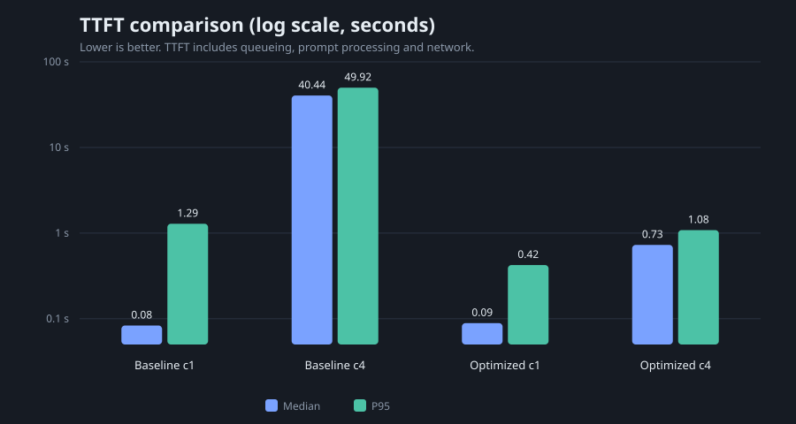
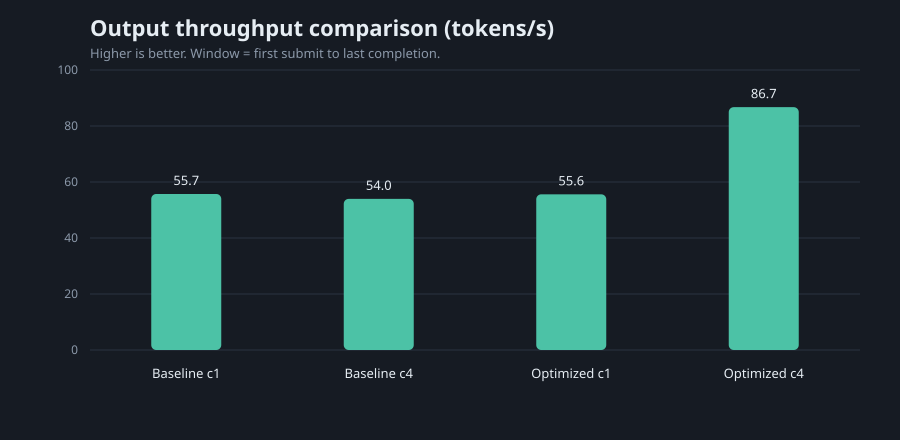

# 基础阶段考核报告

姓名：金琪凯

GitHub 仓库：https://github.com/pt9zwh5yg9-creator/ANTLab-Infra-Tasks

最终分支与 commit SHA：`basic-task`，功能与结果提交 `9316dfd`（最终 HEAD 以仓库为准）

完成日期：2026-10-19

## 执行摘要

- 4 并发下 TTFT 中位数从 **40.44 秒** 降到 **0.73 秒**，降幅约 98.2%；吞吐从 **53.97** 提到 **86.73 tokens/s**，提升约 60.7%。
- 单并发吞吐基本不变（55.72 → 55.60 tokens/s），完成耗时中位数从 13.97 秒降到 13.64 秒。
- 4 个 slot、32k 总上下文和 q8_0 KV 使显存只从 5375 MiB 增到 5400 MiB，仍保留约 2.5 GiB 余量。
- 运行中杀掉 llama-server 后，监督器在 12.756 秒内恢复；4 个逻辑请求全部成功，14 次中断尝试被重试并记录。

## 1. 项目与应用场景

本项目面向 8 人规模的虚构工作室“澄禾工作室”，为其提供本地办公文档处理与辅助编程服务。日常任务包括客户邮件、会议与进度整理、内部制度问答、代码审查和代码修复。首期服务对象为 8 名内部人员，实际同时使用人数预计 1—4 人。

选择本地推理的原因是客户资料和工单数据不适合默认上传到外部服务。系统需要在一台带独立显卡的笔记本上运行，支持文件读取、连续对话和流式输出，并在服务异常退出后能够恢复。

优化目标：

1. 降低多人同时使用时的首 token 延迟。
2. 在不显著增加显存的前提下提高生成吞吐。
3. 保持办公任务和代码任务的基本可用性。
4. 演示服务退出后的检测、重启、就绪确认和请求恢复。

## 2. 环境与模型选择

| 项目 | 配置或说明 |
| --- | --- |
| GPU 型号、显存 | NVIDIA GeForce RTX 5060 Laptop GPU，8151 MiB 专用显存 |
| CPU、内存 | Intel Core Ultra 7 251HX；WSL 内 18 线程，7.5 GiB 可用内存，2 GiB swap |
| Windows、WSL 与 Linux 版本 | Windows 11；WSL2；Ubuntu 24.04；内核 6.18.54.1-microsoft-standard-WSL2 |
| 驱动、CUDA 与构建工具 | NVIDIA 596.56；CUDA Toolkit 13.2.86；GCC 13.3 |
| llama.cpp 版本或 commit | v0.7.0，commit `620d2225cc436ab0b001e3200e590e3b286ef9ab` |
| 模型来源、版本及文件 SHA256 | ModelScope `Qwen/Qwen2.5-7B-Instruct-GGUF`；分片 1 `dfce12e3862a5283ccfb88221b48480e58745165de856439950d0f22590580db`；分片 2 `539cf93f78e887edea1c04e2d7d8cdaca9d01dae9c9025bcb8accbe29df3d72a` |
| 模型参数量与量化格式 | Qwen2.5-7B-Instruct，7.6B，GGUF Q4_K_M |
| 上下文、输出上限、slot 数、KV 类型 | 基线：8192 / 每任务上限 512—2048 / 1 / F16；优化：32768 总上下文、每 slot 8192 / 4 / q8_0 |
| KV 配置总容量、每 slot 可用容量及分配方式 | 基线 8192 tokens、每 slot 8192、独立 slot KV；优化 32768 tokens、每 slot 8192、4 个独立 slot |
| GPU 驻留证据及数据路径 | 启动日志 `offloaded 29/29 layers to GPU`；`CUDA0 model buffer size = 4168.09 MiB`；基线 `CUDA0 KV buffer size = 448.00 MiB`；优化 `CUDA0 KV buffer size = 952.00 MiB`；见 `results/logs/` |

模型选择依据：

- 8 GB 专用显存下，7B Q4_K_M 权重约 4.17 GiB，仍能为 KV 和计算缓冲留出空间。
- Qwen2.5-7B-Instruct 对中文办公任务和 Python 代码任务都有基本覆盖。
- 14B 及以上模型在该显存下难以同时保留 4 个并发 slot 和足够的上下文。
- 使用 q8_0 KV 和 Flash Attention，把 4 倍上下文带来的显存增量控制在约 25 MiB（`nvidia-smi` 实测）。

GPU 驻留证据：

```text
load_tensors: offloaded 29/29 layers to GPU
load_tensors: CUDA0 model buffer size = 4168.09 MiB
llama_kv_cache: CUDA0 KV buffer size = 448.00 MiB      # 基线
llama_kv_cache: CUDA0 KV buffer size = 952.00 MiB      # 优化
sched_reserve: CUDA0 compute buffer size = 501.01 MiB  # 基线
sched_reserve: CUDA0 compute buffer size = 147.09 MiB  # 优化
```

基线运行期间 `nvidia-smi` 报告已用 5375 MiB；优化运行期间报告 5400 MiB，显存余量约 2.5 GiB。

## 3. 系统结构与实现

```text
前端 / 固定负载测试程序
        │ HTTP + SSE
        ▼
FastAPI 服务层 :8000
  ├─ 读取 UTF-8 文件
  ├─ 系统消息 → 资料区 → 任务区
  ├─ 请求 ID、流式转发、错误返回
  └─ 运行记录 / 恢复记录 API
        │
        ▼
llama-server :8080
        │
        ▼
GPU：模型权重 + KV Cache

serve_llama.py 监督器
  ├─ 启动子进程
  ├─ /health 检查
  ├─ 失败后终止、退避、重启
  └─ 记录 supervisor events
```

模块职责：

| 模块 | 职责 | 位置 |
| --- | --- | --- |
| 服务层 | 文件读取、提示词组装、流式转发、请求 ID、静态前端 | `src/app.py` |
| 测试程序 | 固定负载、并发控制、逐请求计时、JSONL 与汇总 | `src/runner.py` |
| 监督器 | 健康检查、异常记录、自动重启、就绪确认 | `src/serve_llama.py` |
| 恢复测试 | 杀进程、重试、恢复耗时、恢复后验证 | `src/recovery_test.py` |
| 前端 | 状态、运行记录、逐请求指标、输出、对比、恢复时间线 | `src/static/` |

输入组织顺序为：系统消息 → 用户消息中的资料区（如有）→ 任务区。文件以 UTF-8 全文读取，文件内容作为待分析资料，不作为指令执行。服务层统一设置 `-cram 0`，关闭主机 RAM prompt cache。

请求 ID 由运行编号、提示词编号、重复编号和随机后缀组成，例如 `optimized_c4_r1-D01-r1-abaecd`。逐请求记录保存文件名、文件 SHA256、输入/输出 token、时间点和输出路径，能够与原始输出相互追踪。

## 4. 输入与工作负载

使用任务提供的 10 条固定任务：

| 编号 | 类型 | 关联文件 | max_tokens |
| --- | --- | --- | ---: |
| P01 | 纯提示词 | — | 512 |
| P02 | 纯提示词 | — | 900 |
| P03 | 纯提示词 | — | 1200 |
| P04 | 纯提示词 | — | 1200 |
| D01 | 文档 | `办公输入01-项目会议与进度资料.md` | 1200 |
| D02 | 文档 | 同上 | 1200 |
| D03 | 文档 | `办公输入02-工作室内部管理制度.md` | 900 |
| D04 | 文档 | 同上 | 900 |
| C01 | 源码 | `编程输入03-ticket_stats.py` | 1200 |
| C02 | 源码 | 同上 | 2048 |

输入文件 SHA256：

| 文件 | SHA256 |
| --- | --- |
| 办公输入01-项目会议与进度资料.md | `ad64b8fbf324344e0c08c17d91c90bdf3c3a39adf2e7ca0ee614f1022dfd5fdb` |
| 办公输入02-工作室内部管理制度.md | `c4aa41b6a1cf4c22e999abefc62a4df10b5abe731d343a430f9ed832ec3e74f4` |
| 编程输入03-ticket_stats.py | `6fa25fb9019072aa13a662896d37fb128050b68dfa6ab40a2c7ccd672ee70e86` |

固定负载定义文件 SHA256：`a278b6abcfba4be111633eefa53b6129c944da5470558ae6ce4144bb4340415a`。

从优化多并发运行（`optimized_c4_r1`）中观察到的输入/输出 token：

| 编号 | 输入 tokens | 输出 tokens |
| --- | ---: | ---: |
| P01 | 141 | 211 |
| P02 | 159 | 900 |
| P03 | 160 | 666 |
| P04 | 144 | 887 |
| D01 | 2289 | 872 |
| D02 | 2276 | 885 |
| D03 | 1849 | 707 |
| D04 | 1827 | 639 |
| C01 | 1647 | 1200 |
| C02 | 1662 | 2048 |

最长单请求约 3710 tokens（C02 输入 1662 + 输出 2048），低于每 slot 8192 的配置上限。本次没有做上下文容量边界扫描，因此不把 KV 容量作为优化指标，只作为配置约束记录。

## 5. 指标与测试方法

| 指标 | 定义 |
| --- | --- |
| TTFT | 客户端提交请求到收到第一个非空 `delta.content` 的时间，包含排队、提示词处理和传输 |
| TPOT | `(完成时间 - 首 token 时间) / max(1, 输出 token 数 - 1)`，排除首 token |
| 完成耗时 | 客户端提交到流结束 |
| 吞吐 | 一次运行的总输出 token 数 / 第一次提交到最后一次完成的墙钟时间 |
| P95 | 对一次运行内请求耗时做最近秩 P95；三轮结果给均值和最小—最大范围 |
| 输入 token | 最终 chunk 的 `timings.cache_n + timings.prompt_n` |
| 输出 token | 最终 chunk 的 `timings.predicted_n` |

测试方法：

- 基线与优化使用相同的 10 条任务、相同顺序、相同系统消息、相同输出上限和采样参数（temperature 0.2，top_p 0.9，seed 42）。
- 单并发使用客户端 1 并发；多并发使用客户端 4 并发。基线服务 1 个 slot，优化服务 4 个 slot。
- 每种配置每种并发各跑 3 轮，每轮 10 条任务；正式统计不使用 `smoke_p01`、`full_c1_smoke`、`optimized_smoke` 三轮冒烟数据。
- 冷启动单独记录：监督器 `server_start` 到 `server_ready` 约 17.6 秒（2026-10-19 16:52:36—16:52:54）。
- 基线与优化均设置 `-cram 0`，关闭主机 RAM prompt cache。正式三轮之间未重启 llama-server，slot KV 状态会保留；两种配置使用相同的“先冒烟、后三轮”流程。
- 测试程序不自动重试正式负载中的失败请求；失败、超时和取消分别记录。恢复测试单独使用最多 8 次重试，并按逻辑请求去重计数。

## 6. 基线结果

基线配置：`-c 8192 -np 1 -fa off -ctk f16 -ctv f16 -cram 0`。

| 运行 | 并发 | 成功/总数 | TTFT 中位数 | TTFT P95 | 完成中位数 | 完成 P95 | TPOT | 吞吐 |
| --- | ---: | ---: | ---: | ---: | ---: | ---: | ---: | ---: |
| baseline_c1_r1 | 1 | 10/10 | 0.0868 s | 1.2263 s | 14.0986 s | 38.4652 s | 18.463 ms | 55.22 tok/s |
| baseline_c1_r2 | 1 | 10/10 | 0.0815 s | 1.3099 s | 13.9840 s | 38.2088 s | 18.389 ms | 55.71 tok/s |
| baseline_c1_r3 | 1 | 10/10 | 0.0818 s | 1.3191 s | 13.8267 s | 38.3790 s | 18.542 ms | 56.22 tok/s |
| baseline_c4_r1 | 4 | 10/10 | 39.1741 s | 52.2122 s | 56.5363 s | 86.6085 s | 18.593 ms | 55.07 tok/s |
| baseline_c4_r2 | 4 | 10/10 | 36.7246 s | 46.9158 s | 49.6183 s | 85.5426 s | 18.561 ms | 54.91 tok/s |
| baseline_c4_r3 | 4 | 10/10 | 45.4266 s | 50.6279 s | 61.4623 s | 92.2661 s | 19.361 ms | 51.92 tok/s |

三轮均值：

| 配置 | 并发 | TTFT 中位数 | TTFT P95 | 完成中位数 | 完成 P95 | TPOT | 吞吐 |
| --- | ---: | ---: | ---: | ---: | ---: | ---: | ---: |
| 基线 | 1 | 0.0833 s | 1.2851 s | 13.9697 s | 38.3510 s | 18.465 ms | 55.72 tok/s |
| 基线 | 4 | 40.4417 s | 49.9186 s | 55.8723 s | 88.1390 s | 18.838 ms | 53.97 tok/s |

分析：

- 单并发下，1 个 slot 的吞吐约 55.7 tokens/s，TTFT 中位数约 83 ms。
- 4 并发下，1 个 slot 只能串行处理，吞吐没有提高（约 54.0 tokens/s，甚至略低），但 TTFT 中位数升至约 40.4 秒，P95 约 49.9 秒。
- 主要瓶颈是 slot 排队，而不是模型解码速度；TPOT 在两种并发下基本不变。

基线显存日志：

```text
CUDA0 model buffer size = 4168.09 MiB
CUDA0 KV buffer size = 448.00 MiB
CUDA0 compute buffer size = 501.01 MiB
CUDA_Host compute buffer size = 46.01 MiB
n_slots = 1, n_ctx_slot = 8192
```

原始数据：`results/runs/baseline_c1_r1..r3`、`results/runs/baseline_c4_r1..r3`。

## 7. 优化过程与效果

优化配置：`-c 32768 -np 4 -fa on -ctk q8_0 -ctv q8_0 -cram 0`。

| 改动 | 目的 | 配置差异 | 实际效果 | 是否保留 |
| --- | --- | --- | --- | --- |
| 增加 slot | 让 4 个客户端请求并行处理，减少排队 | `-np 1 → 4` | 4 并发 TTFT 中位数 40.44 s → 0.73 s；吞吐 53.97 → 86.73 tok/s | 保留 |
| 扩大总上下文 | 4 个 slot 各保留 8192 tokens | `-c 8192 → 32768` | 每 slot 8192；KV buffer 448 → 952 MiB | 保留 |
| 开启 Flash Attention | 降低注意力计算开销和计算缓冲 | `-fa off → on` | 计算缓冲 501 → 147 MiB；单并发完成 P95 38.35 → 36.20 s | 保留 |
| KV 量化 | 抵消 4 倍上下文的显存开销 | `f16 → q8_0` | KV 每 token 约 56 KiB → 约 29.75 KiB；总显存仅 +25 MiB（`nvidia-smi`） | 保留 |
| 关闭主机 prompt cache | 满足基础阶段“KV 驻留 GPU”的要求 | `-cram 0` | 主机 RAM 不保留 prompt cache；slot KV 在 GPU | 保留 |

优化后结果：

| 运行 | 并发 | 成功/总数 | TTFT 中位数 | TTFT P95 | 完成中位数 | 完成 P95 | TPOT | 吞吐 |
| --- | ---: | ---: | ---: | ---: | ---: | ---: | ---: | ---: |
| optimized_c1_r1 | 1 | 10/10 | 0.0932 s | 0.8123 s | 13.7112 s | 36.1775 s | 17.431 ms | 55.51 tok/s |
| optimized_c1_r2 | 1 | 10/10 | 0.0868 s | 0.2147 s | 13.4754 s | 36.2219 s | 17.199 ms | 55.89 tok/s |
| optimized_c1_r3 | 1 | 10/10 | 0.0863 s | 0.2431 s | 13.7464 s | 36.1959 s | 17.555 ms | 55.39 tok/s |
| optimized_c4_r1 | 4 | 10/10 | 0.6969 s | 1.1557 s | 27.7531 s | 54.6541 s | 30.625 ms | 85.18 tok/s |
| optimized_c4_r2 | 4 | 10/10 | 0.7458 s | 1.0423 s | 26.0744 s | 52.9608 s | 29.770 ms | 89.85 tok/s |
| optimized_c4_r3 | 4 | 10/10 | 0.7411 s | 1.0526 s | 27.5327 s | 58.0708 s | 29.954 ms | 85.15 tok/s |

三轮均值对比：

| 指标 | 基线 c1 | 优化 c1 | 变化 | 基线 c4 | 优化 c4 | 变化 |
| --- | ---: | ---: | ---: | ---: | ---: | ---: |
| TTFT 中位数 | 0.0833 s | 0.0888 s | +6.5% | 40.4417 s | 0.7279 s | -98.2%（约 55.6 倍） |
| TTFT P95 | 1.2851 s | 0.4234 s | -67.1% | 49.9186 s | 1.0835 s | -97.8%（约 46.1 倍） |
| 完成中位数 | 13.9697 s | 13.6443 s | -2.3% | 55.8723 s | 27.1201 s | -51.5% |
| 完成 P95 | 38.3510 s | 36.1984 s | -5.6% | 88.1390 s | 55.2285 s | -37.3% |
| TPOT | 18.465 ms | 17.395 ms | -5.8% | 18.838 ms | 30.116 ms | +59.9% |
| 吞吐 | 55.72 tok/s | 55.60 tok/s | -0.2% | 53.97 tok/s | 86.73 tok/s | +60.7% |
| 显存 | 5375 MiB | 5400 MiB | +25 MiB | — | — | — |





逐任务观察（`baseline_c4_r1` 与 `optimized_c4_r1`，单位：秒）：

| 任务 | 输出 tokens | 基线 TTFT | 优化 TTFT | 基线完成耗时 | 优化完成耗时 |
| --- | ---: | ---: | ---: | ---: | ---: |
| P01 | 211 | 35.040 | 0.643 | 39.123 | 6.526 |
| P02 | 900 | 0.289 | 0.625 | 14.242 | 28.948 |
| P03 | 666 | 39.174 | 0.628 | 56.536 | 20.396 |
| P04 | 887 | 14.301 | 0.620 | 34.979 | 27.753 |
| D01 | 872 | 43.590 | 1.156 | 59.274 | 28.604 |
| D02 | 885 | 38.599 | 1.070 | 55.338 | 29.702 |
| D03 | 707 | 52.212 | 0.854 | 62.215 | 23.365 |
| D04 | 639 | 44.843 | 0.901 | 57.520 | 20.003 |
| C01 | 1200 | 41.404 | 0.697 | 64.196 | 45.085 |
| C02 | 2048 | 47.453 | 0.829 | 86.608 | 54.654 |

逐任务表格用于观察长输出任务的影响，不作为严格的同条件对照：基线只有 1 个 slot，P02 因进入第一批处理而 TTFT 很低，其他任务则排在其后。汇总结论以上表的三轮均值为主。优化后 C01、C02 仍是完成耗时最长的任务，主要因为输出上限为 1200 和 2048 tokens；这与模型解码速度有关，不是排队问题。

结论：

- 优化对单并发几乎没有吞吐收益，但完成耗时和 TPOT 略有下降。
- 优化对多并发的收益主要来自 4 个 slot：TTFT 中位数下降约 98%，吞吐提高约 61%。
- 多并发下单请求 TPOT 从 18.8 ms 增至 30.1 ms，说明 4 个请求共享 GPU 时单请求解码变慢；这是并发吞吐提升的代价，但端到端完成耗时和排队时间仍显著改善。
- Flash Attention 与 q8_0 KV 共同抵消了 4 倍上下文带来的显存增长，使优化配置仍能在 8 GB 显卡上运行。

局限：本轮把 slot 数、上下文、Flash Attention 和 KV 精度一起替换，未做完整的单变量矩阵，因此不能把每项改动的贡献完全拆分。后续可增加 `np4 + f16 KV`、`np4 + fa off` 等中间配置，进一步归因。

原始数据：`results/runs/optimized_c1_r1..r3`、`results/runs/optimized_c4_r1..r3`。

## 8. 模型输出效果

检查方法：

- 办公任务核对资料事实、日期、负责人、条款编号和格式。
- 编程任务通读输出，并对最小输入或关键逻辑做人工核对；本轮未把所有生成代码自动执行，失败样例按“是否能满足题目约定”判断。

| 编号 | 检查方法 | 结果与具体样例 | 对场景的影响 | 输出路径 |
| --- | --- | --- | --- | --- |
| P01 | 检查邮件格式、延期原因、新演示安排、后续沟通 | 基本通过；邮件包含主题、原因和下周二演示，但自行补了“上午 10 点”，题目未给出该时间 | 客户沟通可用，但具体时间需人工确认 | `results/runs/optimized_c4_r1/outputs/*P01*.txt` |
| P02 | 检查 5 个工作日、6 人角色、表格、3 项风险 | 失败；输出排到“第 9 天”，违反 5 个工作日约束；风险部分在 900 tokens 处截断 | 计划不可直接执行，需重新生成 | `results/runs/optimized_c4_r1/outputs/*P02*.txt` |
| P03 | 检查返回结构、owner 归一化、状态大小写、测试样例 | 失败；返回值混入顶层 `open/processing/closed/other` 键；`owner=None` 会崩溃，空字符串未归为 `unassigned`；自述测试结果与输入不符 | 调用方无法稳定读取按处理人统计结果 | `results/runs/optimized_c4_r1/outputs/*P03*.txt` |
| P04 | 检查状态、去重、重试上限、持久化、重启恢复 | 部分通过；说明了 SQLite、重试上限和状态，但缺少启动时扫描未完成任务、把 RUNNING 恢复为 PENDING 的流程；表结构没有唯一约束保证去重 | 方案方向正确，代码不能直接作为可靠实现 | `results/runs/optimized_c4_r1/outputs/*P04*.txt` |
| D01 | 核对 10 月 15 日会议、日期、负责人、阻塞项 | 基本通过；总体状态、模块进度、行动项和截止日期与资料一致；“进展顺利”属于判断，应标注为评估；第三个会议问题是推断 | 可直接作为内部摘要，需把判断和待确认项区分 | `results/runs/optimized_c4_r1/outputs/*D01*.txt` |
| D02 | 核对已完成工作、当前问题、交付安排、信息来源 | 通过；事实、日期和来源章节基本准确；称呼“郑宁女士”资料未给出，属于轻微补写 | 可用于客户沟通，发送前需确认称呼 | `results/runs/optimized_c4_r1/outputs/*D02*.txt` |
| D03 | 核对条款编号、办理顺序、验收周例外 | 部分失败；主流程覆盖 B03、C01、A03、C03、B04、D05，但漏了 C02 的“设备借用记录关联远程申请”；验收周把 C02 误写成“更新远程申请”，实际更新远程申请是 B06；D06、D07 是条件性事项，被列为必办 | 用户可能漏办关联登记或做多余步骤，条款引用需要复核 | `results/runs/optimized_c4_r1/outputs/*D03*.txt` |
| D04 | 核对第一周清单、材料、角色、条款 | 基本通过；清单覆盖 A01—A04 和 E03/E04；工作地点/设备变化部分多列了 D05，D05 更偏向远程访问客户资料 | 可作为入职清单，需删去不适用的 D05 | `results/runs/optimized_c4_r1/outputs/*D04*.txt` |
| C01 | 按源码约定检查问题定位和最小复现 | 失败；声称原程序“仅统计第一条重复 ID”，实际原程序没有去重；把缺时区描述为抛 `ValueError`，实际 `fromisoformat` 接受无时区时间；漏掉 owner 缺失、平均耗时口径等关键问题；输出在 1200 tokens 处截断 | 审查结论不可靠，不能直接指导修复 | `results/runs/optimized_c4_r1/outputs/*C01*.txt` |
| C02 | 检查完整修复、去重、平均耗时、测试覆盖 | 失败；没有按 ID 去重，`total` 计入重复工单；平均耗时把未关闭工单的 0 纳入分母并截断成整数；测试主要是 print，不是断言；输出在 2048 tokens 处截断 | 统计结果会错，边界条件未被真正验证 | `results/runs/optimized_c4_r1/outputs/*C02*.txt` |

总体判断：模型在带明确资料依据的办公摘要和客户邮件上表现较好；在需要严格约束（5 个工作日）、结构化返回、边界条件和完整代码输出时失败明显。优化配置没有改变模型权重，因此这些质量问题主要来自模型能力和提示词约束，而不是并发优化本身。后续可通过更明确的输出 schema、分步提示或更大的模型改善。

## 9. 错误记录与服务恢复

恢复测试使用监督器启动优化配置，FastAPI 服务保持运行。测试程序在 4 秒后向 llama-server 发送 `SIGKILL`，同时有 2 个客户端请求在执行。

监督器时间线：

```text
16:52:36.520 supervisor_start
16:52:36.522 server_start（PID 3718）
16:52:54.138 server_ready（PID 3718）
16:53:53.176 health_check_failed（PID 3718）
16:53:53.178 server_exit（PID 3718，exit_code -9）
16:53:53.179 restart_scheduled（restart_count 1，backoff 2 s）
16:53:55.189 server_start（PID 3759）
16:54:05.464 server_ready（PID 3759）
```

恢复测试结果：

| 指标 | 结果 |
| --- | ---: |
| 逻辑请求数 | 4 |
| 成功 | 4 |
| 失败 | 0 |
| 重试次数 | 14 |
| 被中断的尝试 | 14 |
| 杀进程到健康恢复 | 12.756 s |
| 恢复后验证请求 | success |

请求处理策略：

- 等待请求：在客户端信号量中排队；服务恢复后按顺序提交。P01 在杀进程前完成，C02 在恢复后开始，均只尝试 1 次。
- 已发送/生成中的请求：P02、D01 在杀进程时被中断；已生成的部分输出丢弃，使用同一逻辑 `request_id` 重试，逐次记录 attempt、状态和错误。最终成功时只把逻辑请求计为一次成功。
- 失败请求：恢复测试设置最多 8 次重试；如果全部失败，记录为失败并保留错误信息。本次没有请求耗尽重试。
- 重复计数：`requests.jsonl` 保存逻辑请求和 attempts 数组；`summary.json` 的 `total` 按逻辑请求计数，`retries` 和 `interrupted_attempts` 单独统计。

需要说明的边界：当前幂等和重试在测试程序中实现，FastAPI 服务层没有缓存已完成的响应；如果生产环境要求“重试不重复生成”，需要在服务层增加请求 ID 缓存或幂等表。

原始数据：`results/recovery/recovery_r1/`，监督器事件在 `results/recovery/events-20261019-165236.jsonl`。

## 10. 总结与改进

完成情况：

- 在 WSL2 + RTX 5060 Laptop 上完成 llama.cpp CUDA 编译和 GPU 推理。
- 实现文件读取、流式输出、请求 ID、固定负载测试、结果存储和前端展示。
- 完成单并发和 4 并发的基线/优化各 3 轮测试。
- 4 并发 TTFT 中位数从 40.44 秒降到 0.73 秒，吞吐从 53.97 提到 86.73 tokens/s。
- 显存从 5375 MiB 增到 5400 MiB，仍保留约 2.5 GiB 余量。
- 完成运行中杀进程、自动重启、请求重试和恢复后验证。

主要问题：

- 输出质量不稳定，P02、P03、C01、C02 出现明确的约束违反、结构错误或截断。
- 优化是多配置同时替换，单变量归因不完整。
- 未测试 10 并发和 KV 容量边界；4 并发是本次验证上限。
- 正式轮次之间没有重启服务，slot KV 状态会保留；虽然两种配置流程一致，但冷/热缓存影响没有完全拆分。

下一步：

1. 增加输出 schema 校验和自动重试/修复，尤其是 P03、C02 这类结构化任务。
2. 做配置矩阵，拆分 slot、Flash Attention、KV 精度的单独贡献。
3. 在服务层增加请求幂等缓存，避免恢复重试造成重复生成。
4. 测试 8/10 并发和上下文边界，记录 OOM、截断和失败位置。
5. 尝试更大的模型或更强的代码模型，改善代码审查和完整代码生成。

## 11. AI 辅助开发与开源项目使用

使用 Codex/GPT-5 辅助完成：

- 项目目录、FastAPI 服务层、固定负载测试程序、监督器和前端骨架
- 报告和 README 草稿
- 代码走查和部分错误分析

本人在 WSL + RTX 5060 环境中实际执行了 CUDA 编译、模型下载与校验、llama-server 启动、全部正式测试、恢复测试和前端验证；性能数字来自原始 JSONL，输出质量结论来自逐条阅读模型输出和对照输入资料。AI 未参与推理运行时调用链。

开源项目：

| 项目 | 版本/来源 | 用途 |
| --- | --- | --- |
| llama.cpp | v0.7.0，commit `620d2225cc436ab0b001e3200e590e3b286ef9ab` | 推理引擎和 llama-server |
| Qwen2.5-7B-Instruct-GGUF | ModelScope `Qwen/Qwen2.5-7B-Instruct-GGUF` | 模型权重 |
| FastAPI / Uvicorn | 0.144.0 / 0.54.0 | 服务层 |
| HTTPX | 0.28.1 | 流式客户端 |
| Pydantic | 2.14.1 | 请求模型 |

## 12. 复现与数据索引

| 内容 | 路径 |
| --- | --- |
| 服务层 | `src/app.py` |
| 固定负载测试 | `src/runner.py` |
| 监督器 | `src/serve_llama.py` |
| 恢复测试 | `src/recovery_test.py` |
| 前端 | `src/static/` |
| 服务配置 | `configs/service.json` |
| 固定负载 | `configs/workload.json` |
| 基线配置 | `configs/llama-baseline.json` |
| 优化配置 | `configs/llama-optimized.json` |
| 基线原始数据 | `results/runs/baseline_c1_r1..r3`、`results/runs/baseline_c4_r1..r3` |
| 优化原始数据 | `results/runs/optimized_c1_r1..r3`、`results/runs/optimized_c4_r1..r3` |
| 恢复测试 | `results/recovery/recovery_r1/` |
| 监督器事件 | `results/recovery/events-20261019-165236.jsonl` |
| 启动日志 | `results/logs/` |
| 对比图表 | `reports/figures/ttft-comparison.svg`、`reports/figures/throughput-comparison.svg` |
| 本报告 | `reports/基础阶段考核报告.md` |
